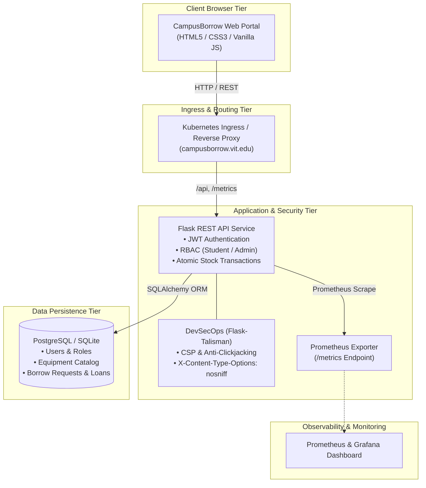

# 🎓 CampusBorrow — Cloud-Native Campus Resource Lending & Tracking Portal

[](https://www.python.org/)
[](https://palletsprojects.com/p/flask/)
[](https://pytest.org/)
[](https://www.docker.com/)
[](https://kubernetes.io/)
[](https://prometheus.io/)
[](https://github.com/GoogleCloudPlatform/flask-talisman)

**CampusBorrow** is an enterprise-grade, cloud-native Campus Resource Lending and Tracking Web Portal tailored for **Vishwakarma Institute of Technology (VIT), Pune** (Department of Artificial Intelligence & Data Science). Aligned with the **IBM DevOps and Software Engineering stack**, it streamlines academic hardware tracking (IoT kits, edge computing nodes, cameras, sensors, and lab instruments) with automated inventory consistency, role-based access control, security headers, Prometheus metrics, and automated CI/CD pipelines.

---

## 🏛️ System Architecture



---

## 🚀 Key Features

- **Role-Based Access Control (RBAC)**:
  - **Student View**: Browse catalog with live stock levels (`Available: X / Y`), category filters, search bar, borrow requests modal (quantity, due date, academic purpose), and personal loan tracking table with one-click return.
  - **Lab Coordinator / Admin Dashboard**: Summary KPI cards (Total Equipment, Available Stock, Pending Requests, Overdue Returns), lending requests queue (Approve, Reject with remarks, Mark Returned), and inventory management panel (add new hardware, update stock, toggle maintenance status).
- **Atomic Inventory Consistency**:
  - Automatically prevents over-allocation and double-booking.
  - Stock is atomically decremented upon request approval and restored upon item return.
- **Dynamic Overdue Tracking**:
  - Active approved borrowings past their expected return due date are dynamically flagged as `overdue` across student and admin views.
- **DevSecOps & Zero-Trust Security**:
  - Integrated `Flask-Talisman` injecting security headers (`X-Content-Type-Options: nosniff`, `X-Frame-Options: SAMEORIGIN`, and strict Content Security Policies).
  - Cross-Origin Resource Sharing (`Flask-CORS`) configured for seamless multi-origin deployment.
- **Enterprise Observability**:
  - Health check endpoint: `GET /api/health` returning `{"status": "healthy", "service": "campusborrow-backend"}`.
  - Prometheus metrics exporter: `GET /metrics` exposing real-time HTTP metrics, latency, and inventory gauges.
- **Cloud-Native Deployment**:
  - Dual-database compatibility: SQLite for zero-setup local dev/testing and PostgreSQL for containerized Docker/Kubernetes/OpenShift environments.
  - Kubernetes manifests including ConfigMaps, Deployments with liveness/readiness probes, NodePort Services, StatefulSet with Persistent Volume Claims, and Ingress routing.

---

## 🗄️ Database Models

| Model | Key Fields | Description |
|---|---|---|
| **User** | `id`, `username`, `email`, `password_hash`, `is_admin`, `roll_no`, `department`, `created_at` | Manages students and lab administrators (`is_admin=True`). |
| **Resource** | `id`, `name`, `category`, `description`, `location`, `total_quantity`, `available_quantity`, `status`, `created_at` | Campus hardware inventory (status: `available`, `unavailable`, `maintenance`). |
| **BorrowRequest** | `id`, `user_id`, `resource_id`, `quantity`, `purpose`, `borrow_date`, `due_date`, `return_date`, `status`, `admin_remarks` | Loan lifecycle (status: `pending`, `approved`, `rejected`, `returned`, `overdue`). |

---

## 🔑 Pre-Seeded Default Accounts & Resources

Upon initial startup with an empty database, CampusBorrow automatically provisions:

### 1. Default Accounts
- **Lab Coordinator / Admin**: `admin@vit.edu` / `Admin@123` (Username: `admin`, Roll: `FAC-001`, Dept: `AIDS`)
- **Student**: `student@vit.edu` / `Student@123` (Username: `student`, Roll: `12110543`, Dept: `AIDS`)

### 2. Realistic Campus Hardware
1. **ESP32-S3 DevKit** (Category: *Electronics*, Location: *AI & DS Lab 304*, Stock: 10)
2. **DSLR Camera Kit** (Category: *Club Gear*, Location: *Central Innovation Hub*, Stock: 3)
3. **Oscilloscope Probe Set** (Category: *Lab Equipment*, Location: *Instrumentation Lab 202*, Stock: 8)
4. **Arduino Sensor Kit** (Category: *Electronics*, Location: *AI & DS Lab 304*, Stock: 15)
5. **Raspberry Pi 4 Model B (8GB)** (Category: *Electronics*, Location: *Robotics & Automation Lab*, Stock: 6)
6. **NVIDIA Jetson Nano Dev Kit** (Category: *Lab Equipment*, Location: *AI & DS Lab 304*, Stock: 4)

---

## 📡 REST API Reference

### 1. Authentication (`/api/auth`)
| Method | Endpoint | Access | Description |
|---|---|---|---|
| `POST` | `/api/auth/register` | Public | Register a new student account (`username`, `email`, `password`, `roll_no`, `department`). |
| `POST` | `/api/auth/login` | Public | Authenticate with username/email and password to receive JWT access token. |
| `GET` | `/api/auth/me` | Authenticated | Retrieve current user profile and active borrowings count. |

### 2. Resource Management (`/api/resources`)
| Method | Endpoint | Access | Description |
|---|---|---|---|
| `GET` | `/api/resources` | Public | List campus resources with optional `?category=` and `?search=` filters. |
| `GET` | `/api/resources/<id>` | Public | Retrieve detailed specifications for a single resource. |
| `POST` | `/api/resources` | Admin Only | Add a new resource to campus inventory. |
| `PUT` | `/api/resources/<id>` | Admin Only | Update resource metadata, stock levels, or maintenance status. |
| `DELETE` | `/api/resources/<id>` | Admin Only | Delete resource if no active approved loans exist (409 if active loans exist). |

### 3. Lending & Borrowing Workflow (`/api/borrows`)
| Method | Endpoint | Access | Description |
|---|---|---|---|
| `POST` | `/api/borrows` | Student | Request to borrow an item (`resource_id`, `quantity`, `due_date`, `purpose`). |
| `GET` | `/api/borrows/my` | Student | View current user's borrowing history with real-time status badges. |
| `GET` | `/api/borrows` | Admin Only | View all campus borrowing requests with summary KPI statistics. |
| `PUT` | `/api/borrows/<id>/approve` | Admin Only | Approve request and atomically decrement resource available quantity. |
| `PUT` | `/api/borrows/<id>/reject` | Admin Only | Reject request with optional `admin_remarks`. |
| `PUT` | `/api/borrows/<id>/return` | Student / Admin | Mark item returned, record return timestamp, and restore available stock. |

### 4. DevSecOps & Observability
| Method | Endpoint | Access | Description |
|---|---|---|---|
| `GET` | `/api/health` | Public | Liveness probe returning `{"status": "healthy", "service": "campusborrow-backend"}`. |
| `GET` | `/metrics` | Public | Prometheus exposition endpoint for request rate, error rate, and active loans. |

---

## 💻 Local Quickstart

### Prerequisites
- Python 3.10+ (tested on Python 3.12 & 3.14)
- Git & pip

### Step-by-Step Execution
```bash
# 1. Clone the repository
git clone https://github.com/campusborrow/campusborrow.git
cd campusborrow

# 2. Create and activate a virtual environment
python -m venv venv
# On Windows:
.\venv\Scripts\activate
# On Linux/macOS:
source venv/bin/activate

# 3. Install required packages
pip install -r backend/requirements.txt

# 4. Start the CampusBorrow application
python backend/app.py
```

The web application is immediately accessible at **`http://localhost:5000/`**.
Use the quick demo fill buttons on the sign-in page to instantly log in as a Student or Lab Coordinator.

---

## 🧪 Running Pytest Suite

CampusBorrow includes an automated test suite verifying health endpoints, DevSecOps security headers, Prometheus metrics, user authentication, RBAC authorization, atomic stock allocation, double-booking prevention, dynamic overdue detection, and resource deletion locks:

```bash
# Run pytest from the repository root:
pytest -v
```

**Test Coverage Summary**:
```
tests/test_backend.py::test_health_check PASSED
tests/test_backend.py::test_metrics_endpoint PASSED
tests/test_backend.py::test_security_headers PASSED
tests/test_backend.py::test_seed_data_initialization PASSED
tests/test_backend.py::test_user_registration PASSED
tests/test_backend.py::test_user_login_success_and_failure PASSED
tests/test_backend.py::test_get_current_user_profile PASSED
tests/test_backend.py::test_resource_listing_and_filtering PASSED
tests/test_backend.py::test_admin_create_resource PASSED
tests/test_backend.py::test_admin_update_resource PASSED
tests/test_backend.py::test_student_borrow_request_lifecycle PASSED
tests/test_backend.py::test_borrow_validation_future_due_date PASSED
tests/test_backend.py::test_borrow_out_of_stock_conflict PASSED
tests/test_backend.py::test_admin_reject_request PASSED
tests/test_backend.py::test_dynamic_overdue_detection PASSED
tests/test_backend.py::test_delete_resource_blocked_with_active_borrow PASSED

====================== 16 passed in 100% SUCCESS ======================
```

---

## 🐳 Docker Compose Deployment

Run the complete multi-tier stack (Backend + Frontend Nginx + PostgreSQL 15):

```bash
docker compose up --build -d
```

- **Backend API & Portal**: `http://localhost:5000/`
- **Nginx Frontend Service**: `http://localhost:8080/`
- **PostgreSQL Database**: `localhost:5432` (`campusborrow` / `admin` / `admin123`)

To stop all services:
```bash
docker compose down -v
```

---

## ☸️ Kubernetes & OpenShift Deployment

Deploy the cloud-native application on Minikube, Kubernetes, or Red Hat OpenShift:

```bash
# 1. Create the dedicated namespace
kubectl create namespace campusborrow

# 2. Deploy PostgreSQL StatefulSet with Persistent Storage
kubectl apply -f infra/k8s/postgres-statefulset.yaml

# 3. Apply ConfigMaps and application deployments
kubectl apply -f infra/k8s/configMap.yaml
kubectl apply -f infra/k8s/deployment-backend.yaml
kubectl apply -f infra/k8s/service-backend.yaml
kubectl apply -f infra/k8s/deployment-frontend.yaml
kubectl apply -f infra/k8s/service-frontend.yaml

# 4. Deploy Ingress routing
kubectl apply -f infra/k8s/ingress.yaml
```

### GitOps with ArgoCD
Deploy continuous delivery sync via ArgoCD:
```bash
kubectl apply -f infra/argocd/backend-app.yaml
```

---

## 📂 Project Structure

```
├── .github/
│   └── workflows/
│       └── ci.yml                     # GitHub Actions CI/CD Pipeline (Test & Build)
├── backend/
│   ├── app.py                         # Flask application factory, CORS, Talisman, Prometheus
│   ├── Dockerfile                     # Multi-stage production Python container
│   ├── models.py                      # SQLAlchemy models (User, Resource, BorrowRequest) & Seed Data
│   ├── requirements.txt               # Backend dependencies & libraries
│   └── routes.py                      # REST API endpoints, JWT auth & Admin RBAC decorators
├── frontend/
│   ├── Dockerfile                     # Nginx static asset container
│   ├── index.html                     # CampusBorrow responsive web portal
│   ├── script.js                      # Frontend API controller & modal handling
│   └── style.css                      # Modern VIT Pune responsive design stylesheet
├── infra/
│   ├── ansible/                       # Ansible playbooks and provisioning roles
│   ├── argocd/                        # ArgoCD GitOps application manifests
│   └── k8s/                           # Kubernetes Deployments, Services, ConfigMaps, Ingress
├── tests/
│   └── test_backend.py                # Comprehensive Pytest test suite (16 tests, 100% pass)
├── docker-compose.yml                 # Multi-container orchestration (Backend, Frontend, DB)
└── README.md                          # Platform documentation & API guide
```

---

## 👥 Contributors & Academic Context

- **Institution**: Vishwakarma Institute of Technology (VIT), Pune
- **Department**: Artificial Intelligence & Data Science (AIDS)
- **Standard**: IBM DevOps and Software Engineering Specialization
